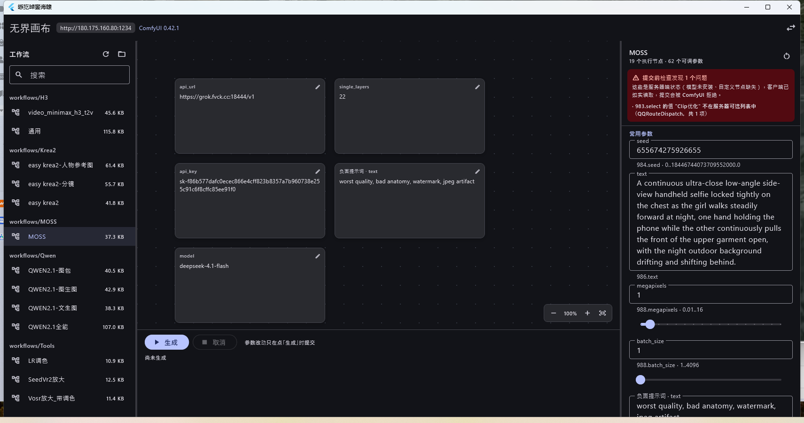

# 无界画布 · Wuxianhuabu

一个 **Flutter 桌面版 ComfyUI 无限画布**。支持本地与远程实例，**直接读取 ComfyUI 画布工作流，不需要导入 API 格式的流水线 JSON**，不依赖浏览器启动。

Windows x64 本机构建已验证；macOS arm64 由同一套 Dart 代码在 CI 上构建。



---

## 它解决什么问题

官方做法是「在 ComfyUI 网页里把工作流导出成 API JSON，再喂给别的程序」。这带来三个麻烦：导出是手工的、工作流一改就要重导、导出过程要开浏览器。

本项目反过来：客户端连上 ComfyUI，**直接列它已保存的工作流**（UI 格式），自己在本地把图展开成 `POST /prompt` 需要的 API 结构，然后按图结构**自动生成参数表单**。你在 ComfyUI 里改了工作流，客户端刷新一下就跟着变。

## 已验证的事实

以下都是在真实实例（ComfyUI **0.42.1**，**4073** 个节点类型）上跑出来的，不是设计假设：

| 能力 | 验证方式 |
|---|---|
| 子图（含嵌套）展开 | 20 组真实执行记录逐字段比对，通过 |
| `SetNode` / `GetNode` 解析 | 真实工作流中 71 次虚拟节点全部正确处理 |
| 旁路 / 静音节点 | `mode=4` 正确透传，`mode=2` 正确剔除 |
| 参数表单自动生成 | MOSS 工作流生成 62 个可调参数 |
| 端到端出片 | 提交 → 跟踪 → 下载，产出 `Wsl_20261030-1205.mp4` |
| 认证（`X-Api-Key`） | 无 key 返回 401，带 key 正常 |

**26 个真实工作流中 18 个通过服务器校验**；其余 8 个的失败原因全部来自服务器端状态（模型未安装、自定义节点缺失、保存的 JSON 与实例不同步），客户端会在**提交前**就报出来，而不是等 ComfyUI 拒绝。

## 快速开始

### 环境要求

- Windows 10/11（x64）或 macOS（Apple Silicon）
- 一份可访问的 ComfyUI（本地或远程）

Windows 构建需要：Flutter 3.47+、Visual Studio 2022 Build Tools（含 `VC.Tools.x86.x64`、`VC.CMake.Project`、**`VC.ATL`**、Windows SDK）。`flutter_secure_storage` 的 Windows 实现依赖 ATL，缺它会在链接阶段报 `atlstr.h` 找不到。

### 构建

```bash
flutter pub get
flutter test                      # 75 个离线测试
flutter build windows --release   # 产物在 build/windows/x64/runner/Release/
```

macOS：

```bash
flutter build macos --release     # 必须在 macOS 上执行，需 Xcode
```

### 连接

启动后填地址 + 认证方式即可。认证方式支持：

| 方式 | 用途 |
|---|---|
| 无认证 | 本机默认。ComfyUI 本身不带认证 |
| `X-Api-Key` | 网关/反代最常用 |
| `Bearer Token` | `ComfyUI-Login`、各类网关 |
| `HTTP Basic` | nginx `auth_basic` |
| 自定义请求头 | Cloudflare Access 等边缘代理 |
| 查询参数 Token | `ComfyUI-Login` 的 `?token=` 兜底 |
| Cookie 会话登录 | `ComfyUI-Login` 表单登录 |

反代路径前缀（如 `https://host/comfy`）会被保留到所有请求和 WebSocket 上。

> 认证头同时作用于 **WebSocket 握手**。只给 HTTP 加认证的客户端会「出图正常但永远没有进度」，这个坑在代码里已经堵上。

## 架构

```
┌──────────────────────── Flutter 桌面应用（单进程，无浏览器） ────────────────────────┐
│  UI        连接界面 · 工作流库 · 无限画布 · 参数表单 · 运行面板                          │
│  状态      Riverpod providers：连接 / 参数 / 画布                                       │
│  领域      WorkflowExpander（UI→API）· ParameterExtractor · PromptPatcher               │
│  基础设施  ComfyClient（HTTP + WS）· ProfileStore · CanvasStore                          │
└───────────────────────────────────┬─────────────────────────────────────────────────────┘
                                    │ HTTP(S) / WS(S)  + 认证头
                     ┌──────────────┴──────────────┐
                     │  ComfyUI 0.x（本地 / 远程）   │
                     └─────────────────────────────┘
```

### 关键设计取舍

**展开器在客户端，不在服务端。** 官方前端靠 `app.graphToPrompt()` 在浏览器里展开。桌面端没有浏览器，所以展开逻辑必须自己实现——这也是本项目最大的技术风险点，因此它被单独测试、并用真实执行记录做对照。

**WebSocket 只是信号，不是真相。** 完成/失败一律以 `/history` 轮询为准。反代不支持 WS 升级很常见，那时进度会退化成轮询，但出图不受影响。

**画布自己实现，不用节点编辑器库。** 卡片是异构的（图片、文本、配置），不是类型化端口图。用 `Matrix4` 做世界坐标，只构建可视区卡片。

**JSON 文件而非 SQLite。** 画布是少量文档、防抖写入，原子重命名即可获得崩溃安全；数据库会引入双平台原生依赖。

## 目录

```
lib/src/graph/      工作流解析与展开（纯 Dart，无 Flutter 依赖）
  ui_workflow.dart        UI 格式解析（两种 links 形态、子图定义、widget 标记）
  workflow_expander.dart  展开核心：子图 / Set-Get / Reroute / 旁路 / 值广播
  parameter_extractor.dart 参数提取
  prompt_patcher.dart     参数写回
  node_definition.dart    /object_info 解析与提交前校验
lib/src/core/       ComfyClient、认证、连接配置、工作流服务
lib/src/state/      Riverpod providers、持久化
lib/src/ui/         界面
test/               75 个离线测试 + 6 个需真实实例的测试
tools/              抓取真实工作流 / 导出执行记录作为测试语料的脚本
```

## 测试

```bash
flutter test                                        # 离线：75 通过
```

需要真实实例的测试默认跳过：

```bash
COMFYUI_URL=http://host:1234 \
COMFYUI_AUTH_TOKEN=sk-... \
flutter test test/live_instance_test.dart

# 真的跑一次生成（会占 GPU）
COMFYUI_URL=... COMFYUI_AUTH_TOKEN=... COMFYUI_GENERATE=1 \
flutter test test/live_generation_test.dart
```

### 测试语料怎么来的

`tools/` 下的脚本从真实实例抓了两类语料：

1. `tools/fixtures/*.json` —— 13 条已保存的真实工作流。
2. `tools/fixtures/history/pairs.json` —— 20 组 **UI 工作流 + ComfyUI 实际执行的 API prompt** 配对。

第 2 类是最强的判据：它直接给出「这个图应该展开成什么」。展开器的正确性就是拿它逐字段比对出来的——包括当初发现的两个真实 bug（旁路节点需要从同类型输入拼接、`QQ-多值输入` 这类值广播节点要内联字面量而不是连线）。

```bash
py tools/fetch_workflows.py          # 重新抓工作流
py tools/export_history_pairs.py     # 重新导出执行记录
```

## 已知限制

- **macOS 产物未在真机验证**，只在 CI 上编译通过。
- **二进制未签名**：Windows 会触发 SmartScreen，macOS 需要手动放行（未公证）。
- **未实现**：蒙版/局部重绘、超分、视频插帧等特化 UI。
- 参数暴露依赖子图提升输入 / Primitive 节点 / widget 直读；自定义节点的动态控件若无声明，可能不出现在表单里。
- 保存的 JSON 与实例不同步（模型被删、节点未装）时会拒绝提交——这是**正确行为**，客户端会在提交前说明原因。

## 许可

MIT。见 [LICENSE](LICENSE) 与 [NOTICE.md](NOTICE.md)。
